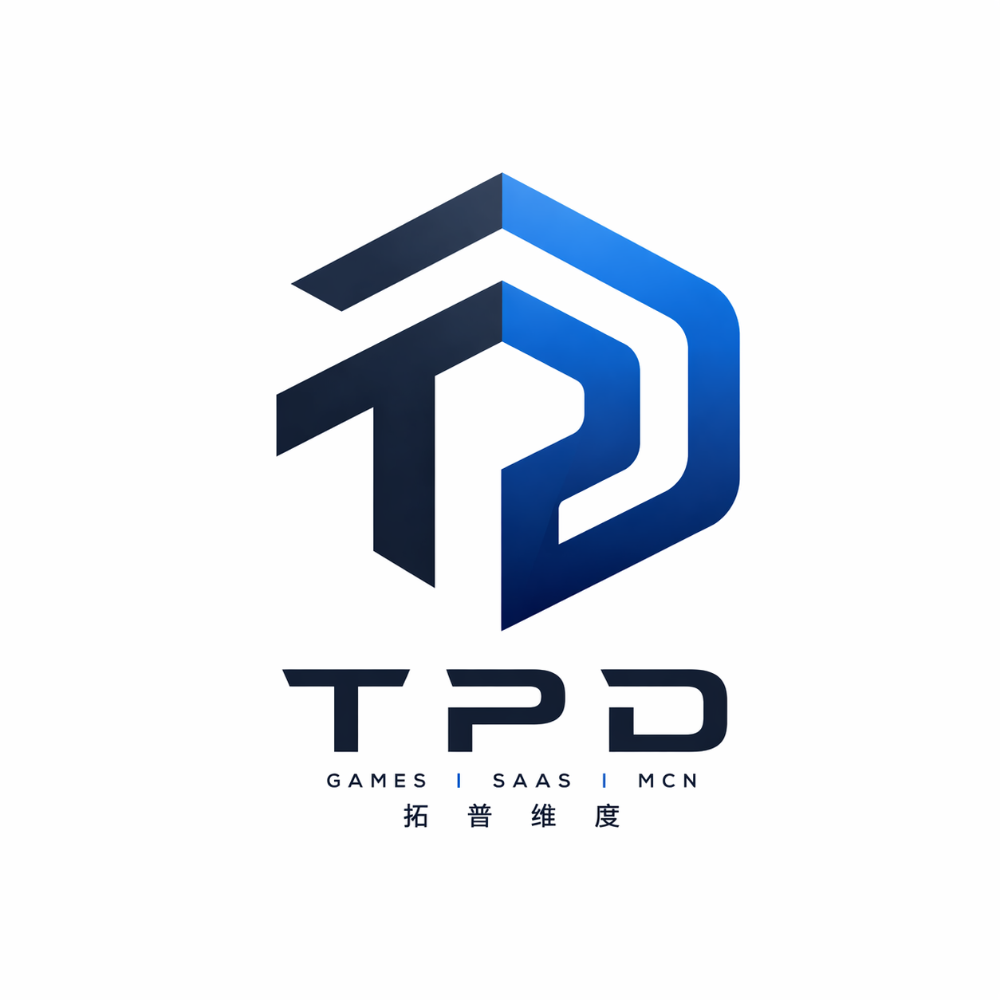

  

<h1 align="center">潍坊拓普维度文化科技有限公司</h1>
<h3 align="center">Weifang Top Dimension Culture Technology Co., Ltd.</h3>

---

## 🌟 公司简介

**潍坊拓普维度文化科技有限公司**（简称拓普维度）是一家立足潍坊、面向全国的综合型科技文化企业。公司汇聚了一批经验丰富的技术人才与创意精英，致力于将前沿技术转化为卓越的产品与服务，为客户创造持续价值。

拓普维度始终坚持"技术为本、创新为魂"的发展理念，在游戏研发、SaaS 平台建设及定制化软件开发等领域积累了深厚的技术储备和丰富的项目经验。我们以严谨的开发流程、敏捷的交付能力和完善的服务体系，赢得了众多客户的信赖与好评。

---

## 💼 核心业务

### 🎮 游戏开发

我们拥有一支充满激情与创造力的游戏开发团队，从策划、美术、程序到测试，全流程自主把控。团队擅长多种引擎技术栈（Unity、Unreal Engine 等），能够针对不同平台（PC、移动端、Web）打造高品质、富有沉浸感的游戏体验。无论是独立创意小品，还是大型商业项目，拓普维度都能以专业的姿态交付令人满意的作品。

- 游戏策划与世界观构建
- 2D/3D 美术设计与制作
- 客户端与服务端开发
- 性能优化与多平台适配
- 上线运营与持续迭代

### ☁️ SaaS 开发与运营

拓普维度为企业提供全生命周期的 SaaS 产品解决方案，涵盖需求分析、架构设计、前后端开发、云原生部署及长期运维。我们采用现代化的技术栈（微服务架构、容器化部署、分布式存储等），确保平台的高可用性、弹性扩展能力与数据安全性。

- SaaS 平台从 0 到 1 搭建
- 多租户架构设计与实现
- 支付、权限、消息等通用模块集成
- 云原生部署与自动化运维
- 数据看板与运营分析

### 🔧 外包开发服务

针对企业客户的个性化需求，拓普维度提供灵活的定制化软件开发服务。无论是 Web 应用、移动 App、小程序，还是企业内部管理系统，我们都能够快速响应、精准落地。我们以结果为导向，注重代码质量与项目文档，确保交付的软件可维护、可扩展。

- 定制化 Web / 移动端应用开发
- 小程序 / 公众号开发
- 企业管理系统与自动化工具
- API 接口开发与第三方系统集成
- 遗留系统重构与迁移

---

## 🏆 我们的优势

- ✅ **全栈能力** — 从前端到后端、从设计到运维，一站式交付
- ✅ **敏捷高效** — 采用 Scrum 开发流程，快速迭代，及时响应变化
- ✅ **品质保障** — 完善的代码审查与自动化测试体系，确保交付质量
- ✅ **持续服务** — 项目交付后提供长期技术支持和运维保障
- ✅ **性价比优** — 以合理的成本提供高品质的技术服务

---

## 📞 联系方式

| 方式 | 信息 |
|------|------|
| 📧 **电子邮箱** | [sanyou123666@tpdsite.com](mailto:sanyou123666@tpdsite.com) |
| 🌐 **官方网站** | [https://www.tpdsite.com/](https://www.tpdsite.com/) |

欢迎各界朋友、合作伙伴前来沟通交流，共同探索数字时代的无限可能！

---

  © 2026 潍坊拓普维度文化科技有限公司 All Rights Reserved.

